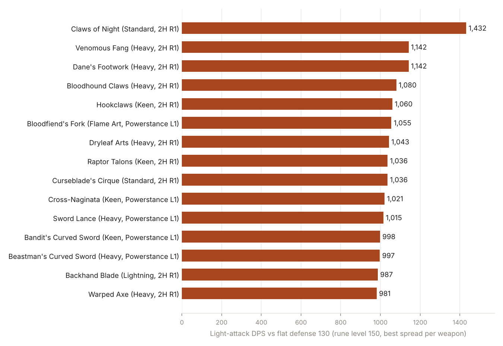

# Elden Ring: light-attack DPS for every weapon, from game data

Sustained light-attack DPS for every melee weapon and infusion in Elden Ring (Shadow of the Erdtree included):
1H R1, 2H R1 and powerstance L1 chains, with the stat spread that maximises each one, against a flat defense or
against real bosses with their HP, defenses, absorption, bleed and frost.

Everything about the game comes from the game files: attack and cancel frames from `c0000.anibnd` (TAE), motion
values and hitboxes from `BehaviorParam_PC` / `AtkParam_Pc`, weapon numbers from `EquipParamWeapon` and
`ReinforceParamWeapon`, bosses from `NpcParam` and `SpEffectParam`. Nothing is written to the game folder.

**Interactive calculator:** [heyobi.github.io/er-frame-dps](https://heyobi.github.io/er-frame-dps/) (starting
class, rune level and Vigor/Mind/Endurance in, best spread per weapon out; pick a boss for bleed, frost and time to
kill; click a weapon for its attack chain and DPS by rune level).

Same idea for Dark Souls III: [heyobi/ds3-frame-dps](https://github.com/heyobi/ds3-frame-dps).

**Status:** the model matches a reference calculator on attack rating and matches the wiki on hit counts where I
could check, but none of it has been timed in game yet. Corrections and in-game tests are very welcome.

## Headline result

_Tables are being generated, back in a few minutes._

Every weapon is at max upgrade (+25, or +10 for somber weapons), no buffs, no talismans. Starting from Wretch (all
stats 10) at rune level 150 with 60 Vigor, 15 Mind and 25 Endurance leaves 79 points for Str/Dex/Int/Fai/Arc, and
each weapon gets the spread that is best for it. "Hits per step" lists how many hits each step of the chain lands.



## Against bosses

The same search, but the target is a real boss: its HP, defense and absorption per damage type (with the area
scaling it has in game), its bleed and frost resistance, how much that resistance grows after each proc, and its
own bleed and frost damage rates. DPS here means HP divided by time to kill, so status procs count.

_Tables are being generated, back in a few minutes._

Full tables for these and other bosses: [`results/rankings.md`](results/rankings.md), or pick any of 27 bosses in the calculator.

## Method

**Attack chains.** Each light-attack step is an animation in the weapon class's TAE (`a<2000 + wepmotionCategory>`,
checking the weapon's special category first). 1H R1 starts at animation 30000, 2H R1 at 32000 and powerstance /
dual L1 at 34000, one animation per step (+10). A step lasts until its first R1-cancel flag (TAE flag 4 or 115),
the first frame the next attack can start; the chain loops after its last step. DPS = damage of the whole chain
divided by its length at 60 fps.

**Hits.** Every `AttackBehavior` event that starts before the cancel is a hit window, with its behavior judge id
pointing into `BehaviorParam_PC` → `AtkParam_Pc` for motion values and attack type. Windows of the same hand that
touch or overlap are phases of one swing and count once (the strongest phase); different hands, or windows separated
in time, count separately. Light greatswords also carry stamina-free 99x hitboxes; they are dropped because the
wiki's hit counts (5th light attack hits twice, 3rd dual attack 3 times, 4th dual attack 4 times) only come out
right without them.

**Attack rating.** Base damage × upgrade rate × (1 + Σ scaling × stat curve), using `AttackElementCorrectParam`
for which stat scales which element and `CalcCorrectGraph` for the curves. Two-handing multiplies Strength by 1.5,
except on paired weapons. An unmet requirement gives −40% on every element that stat scales (and on bleed for
Arcane). `tools/validate_ar.py` compares this with
[ThomasJClark's Elden Ring weapon calculator](https://github.com/ThomasJClark/elden-ring-weapon-calculator) on 2400
random weapon / stat / upgrade cases: every melee weapon matches within 0.6 AR, and bleed and frost buildup match too.
(Bows differ because that calculator always two-hands them; this model leaves bows out.)

**Damage.** Each element goes through the usual Souls attack/defense curve against the target's defense, times
the target's absorption for that damage type (standard, slash, strike, pierce, magic, fire, lightning, holy).
The curve is the community-derived formula; it is not stored in the game data.

**Bleed and frost.** Buildup per hit comes from the weapon's status SpEffect at its upgrade level, with Arcane
scaling where the weapon has it. Proc damage comes from the same SpEffect: bleed 15% of max HP + 100, frost 10% + 30,
and frostbite makes the target take 20% more damage for 30 s (all read from `SpEffectParam`). A boss's resistance
rises after each proc by its `ResistCorrectParam` row, and its bleed / frost damage rate scales the proc. Time to
kill is an event simulation of direct damage plus procs.

**Stat search.** Requirements first, then one point at a time to whichever stat raises direct DPS most per point
(looking 1 to 20 points ahead so slow-starting curves are not skipped). Against a boss, bleed weapons then move
points into Arcane while that kills faster.

## What is not in the model

Buildup decay (so frost may look a bit better than it is against bosses you cannot hit constantly), stamina,
poise and stagger, buffs and talismans, weapon skills, heavy and running attacks, poison / rot / sleep / madness,
upgrade levels below max (calculator), and in-game timing tests. Powerstance assumes two copies of the weapon;
some unique weapons only have one per playthrough (paired weapons need just one).

## Files

| Path | What it is |
|---|---|
| `tools/er_extract.py` + `er_keys.json` | Read-only extractor for the encrypted archives (`Data0-3`, `DLC`), e.g. `/chr/c0000.anibnd.dcx` |
| `krak/` | Tiny Rust wrapper around the `oozextract` crate to decompress Oodle Kraken DCX files |
| `tools/er_regulation.py` | Decrypts `regulation.bin` and writes every `.param` |
| `tools/er_load.py` | Params + TAE → `er.pkl` (uses `param_reader.py` with Paramdex layouts and the TAE / BND reader in `ds3_frames.py`) |
| `tools/er_model.py` | Attack rating, chains, hit grouping, bosses, status, time-to-kill simulation |
| `tools/er_rank.py` | Stat search for every weapon / infusion / move; writes the markdown tables |
| `tools/export_web.py` | Builds `docs/data.json` for the calculator |
| `tools/validate_ar.py` + `validate_ar_ref.ts` | AR check against the reference calculator |
| `docs/` | The calculator (static page; `docs/calc.js` is the same model in JavaScript) |
| `results/` | Generated tables and chart |

## Reproduce

```sh
# 1. game files (read-only)
python3 tools/er_extract.py "<steam>/ELDEN RING/Game" er_files /chr/c0000.anibnd.dcx
(cd krak && cargo build --release)
krak/target/release/krak er_files/<Archive>__chr__c0000.anibnd.dcx er_files/c0000.anibnd   # the DLC__ copy if there are two
python3 tools/er_regulation.py "<steam>/ELDEN RING/Game/regulation.bin" er_files
# 2. model
git clone https://github.com/soulsmods/Paramdex
export ER_FILES=er_files PARAMDEX_ER=Paramdex/ER
python3 tools/er_load.py
python3 tools/er_rank.py --budget 79 "Malenia, Blade of Miquella" > results/rankings.md
python3 tools/export_web.py --out docs/data.json
```

## Credits

Param layouts from [Paramdex](https://github.com/soulsmods/Paramdex), archive keys from UXM Selective Unpacker,
file formats from SoulsFormats, AR reference from ThomasJClark's calculator, hit counts cross-checked against
[eldenring.wiki.gg](https://eldenring.wiki.gg/wiki/Light_Greatswords).

MIT license.
